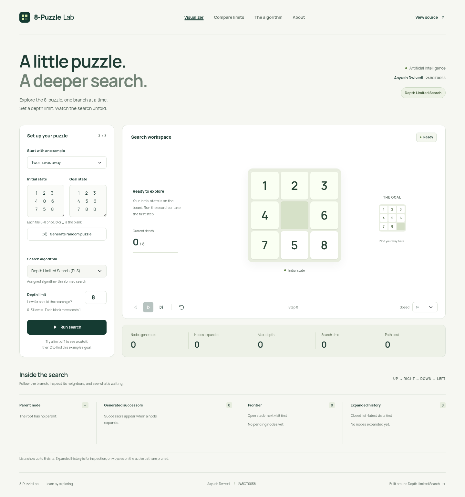
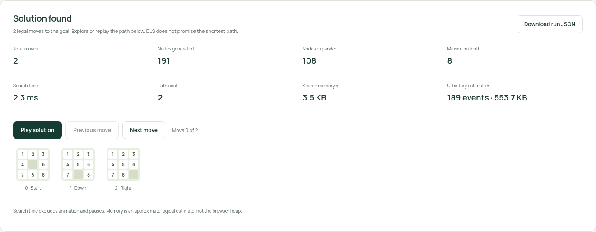
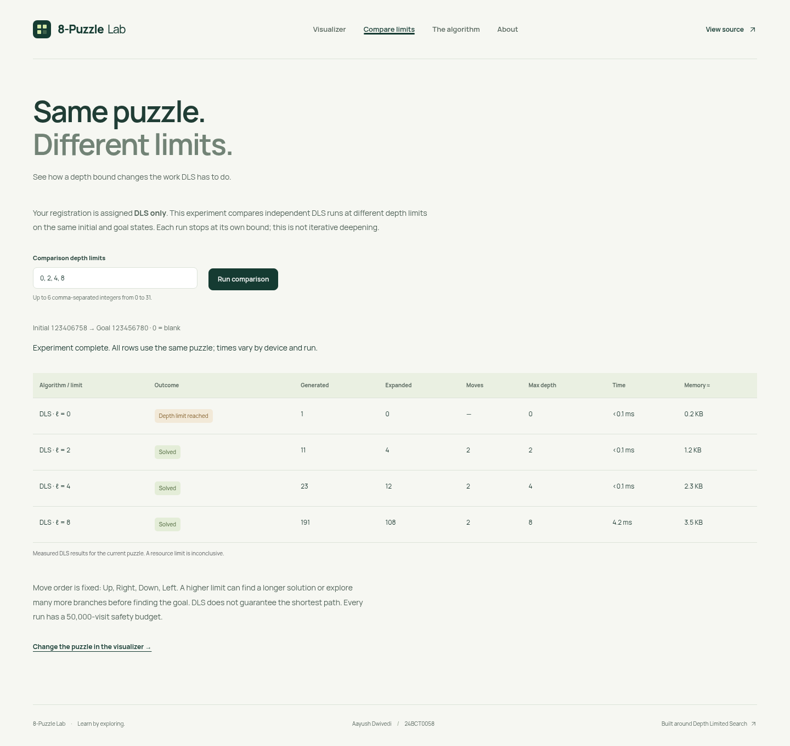
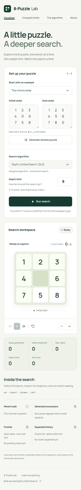

# 8-Puzzle Lab — Depth Limited Search

Interactive state-space search lab for **Artificial Intelligence — Digital Assignment (Case Study)**.

**Aayush Dwivedi · 24BCT0058**

- **Live website:** https://skapyskar.github.io/ai-vit-da/
- **Repository:** https://github.com/skapyskar/ai-vit-da
- **Assignment:** [Original PDF](Artificial%20Intelligence%20QP%201.pdf)
- **Submission PDF:** [24BCT0058-submission.pdf](docs/24BCT0058-submission.pdf)
- **Demonstration video:** [Narrated screen walkthrough](docs/24BCT0058-dls-demo.mp4) (synthetic voice)



## Assigned scope

The allocation table assigns **24BCT0058 → algorithm 3 → Depth Limited Search (DLS)**. The assignment and student request explicitly restrict implementation to the designated algorithm. **DLS is the only implemented search algorithm.**

The generic comparison requirement is adapted to measured independent DLS runs at different depth limits on the **same puzzle**. These are separate experiments, not iterative deepening. No results for unimplemented algorithms are invented. DLS is uninformed and uses **no heuristic**; Manhattan Distance and Misplaced Tiles are not applicable. See [scope and measurements](docs/assignment-scope.md).

## Features

- Manual initial and goal states; compact digits, whitespace, comma separators and `_` blanks.
- Random solvable puzzles relative to any goal, validated by inversion parity.
- DLS from scratch, deterministic **Up → Right → Down → Left** order and active-path cycle prevention.
- Animated current state, parent, successors, frontier stack and expanded history.
- Run, pause/resume, next/previous search event, reset and playback speed controls.
- Separately playable solution path with selectable states and individual move controls.
- Live generated/expanded counts, depth, cost, measured computation time and approximate memory.
- Explicit solved, cutoff, parity error and resource-limit outcomes.
- Depth-limit comparisons, JSON export, algorithm explanation and student details.
- Responsive layouts, keyboard controls, reduced-motion support and local runtime assets.

## Run locally

No installation or build is needed to use the application. Serve over HTTP; ES modules do not work reliably through `file://`:

```sh
python3 -m http.server 8080 --bind 127.0.0.1
```

Open **http://127.0.0.1:8080**. Alternatively use `npm start`. No backend, API key or CDN is required.

## Quick demonstration

1. Keep the default puzzle; set limit **1** and speed **Instant**. Run: the result is a cutoff.
2. Reset; set limit **2** and run. DLS finds **Down → Right**, with cost 2.
3. Use Previous/Next to inspect search events. Play the solution to see legal moves.
4. Compare limits **0, 2, 4, 8**. Larger bounds may expand more visits even when the final move count is unchanged.
5. Try the assignment example, a random puzzle or a custom goal.

The default limit 8 exposes more of the search tree. Limit 2 is useful for a short live demonstration. [Full 3–5 minute demonstration guide](docs/demo-guide.md).





<details>
<summary>Mobile screenshot</summary>



</details>

## Technologies and structure

HTML5, CSS3, JavaScript ES modules, Bootstrap **5.3.8** and Manrope. Node.js **22+** is used for development checks; Python 3 runs the local server.

```text
index.html                     Four hash-addressed application views
css/styles.css                 Responsive theme and tile transitions
js/puzzle.js                   Validation, legal moves, parity, random walks
js/dls.js                      Incremental DLS and measurements
js/app.js                      Controls, history, experiments and export
assets/                        Local Bootstrap, font, icon and font license
images/                        Real application screenshots
tests/                         Node unit tests and browser journeys
scripts/                       Build, screenshots and submission helpers
docs/                          Scope, demonstration, validation and submission
.github/workflows/pages.yml    Tests and GitHub Pages deployment
```

## Algorithm and measurements

With branching factor b and depth bound ℓ, DLS has worst-case time **O(b^ℓ)** and search working storage **O(bℓ)**. Retaining up to **2,000 visualization events** adds separate storage. The app visits at most **50,000 nodes per run** and permits limits **0–31** to protect responsiveness.

- **Generated:** root plus successor visits admitted to the frontier, including the same board on different paths.
- **Expanded:** visits whose successors are generated. Goals and cutoff nodes are not expanded.
- **Maximum depth:** deepest visited node; it need not equal solution depth.
- **Time:** computation only, excluding animation, rendering and user pauses.
- **Memory:** peak logical node-storage estimate, **not a measured browser heap**. UI history has a separate rough estimate.
- **Closed list:** recent expanded visits for inspection. It does not globally prune states; cycle prevention uses the current ancestor path only.

A cutoff means the bound prevented further exploration; it does not prove unsolvability. A resource limit is inconclusive. DLS can find a solution within the bound if allowed to finish, but does not guarantee a shortest path. Random walk length is not a measured optimal difficulty.

## Development checks

```sh
npm ci --ignore-scripts
npx playwright install --with-deps chromium
npm run check
npm test
npm run test:coverage
npm run test:e2e
npm run format:check
npm run build
```

The build copies an explicit public-file allowlist into `_site/`. Tests cover depth boundaries, paths, parity, input errors, pause/reset/replay, comparison invalidation, responsive overflow and automated axe accessibility checks. [Validation evidence and limitations](docs/validation.md).

For an existing browser, set `PLAYWRIGHT_CHROMIUM_EXECUTABLE_PATH` to its executable; otherwise Playwright uses its matching downloaded Chromium.

## GitHub Pages

Choose **Settings → Pages → Source → GitHub Actions**. The workflow validates the app, uploads `_site/`, and deploys pushes to `main`. Pull requests run checks without deploying. No personal access token or external hosting service is required.

Based on the [official static-site workflow](https://github.com/actions/starter-workflows/blob/main/pages/static.yml) and [GitHub Pages publishing documentation](https://docs.github.com/en/pages/getting-started-with-github-pages/configuring-a-publishing-source-for-your-github-pages-site).

## References and acknowledgments

- [Assignment PDF](Artificial%20Intelligence%20QP%201.pdf), algorithm list on page 1 and allocation table on page 10.
- Russell and Norvig, [Artificial Intelligence: A Modern Approach](https://aima.cs.berkeley.edu/), search concepts.
- [MDN generators](https://developer.mozilla.org/en-US/docs/Web/JavaScript/Reference/Statements/function*), incremental execution.
- [Bootstrap](https://getbootstrap.com/docs/5.3/), MIT license; notice preserved in the local stylesheet.
- [Manrope by Mikhail Sharanda](https://github.com/sharanda/manrope), SIL Open Font License; included in `assets/Manrope-LICENSE.txt`.
- [Playwright](https://playwright.dev/) and [axe-core](https://github.com/dequelabs/axe-core), development testing.
- OpenAI Codex assisted with implementation, tests, documentation and demonstration preparation. The supplied walkthrough uses synthetic narration. Review the source and explain the implementation in your own demonstration.
